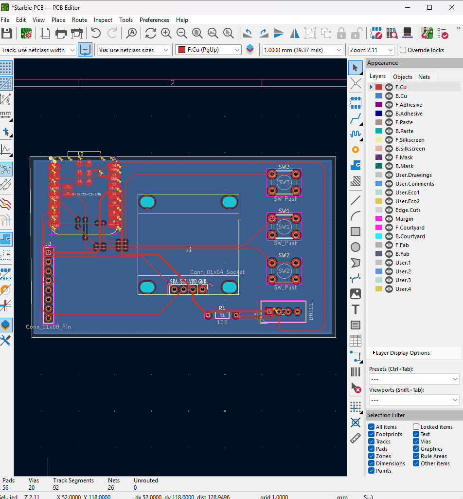

# Not a Starboy 🎮🕹️⭐

Not a Starboy is motion and button controlled electronic pet built on the Seeed Studio XIAO ESP32-C3 and inspired by the hardware trends of the 1980s retro gaming era.

## Modifcations
While this project was inspired by the Half-life Week 1 Starter project, Starbie, I have made several modifications to make it my own:
* My PXB board has a custom layout and shape 

